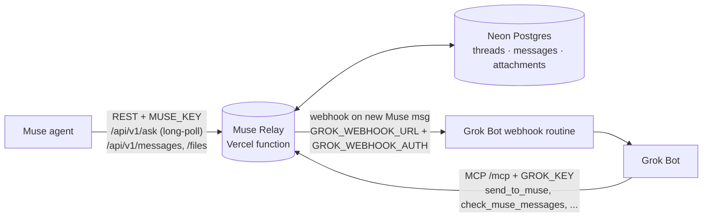

# Muse Relay — a two-way bridge between Meta Muse and Grok Bot

Let your **Muse** agent and your **Grok Bot** talk to each other directly — questions, answers, and files — with no laptop in the loop.
Runs free on **Vercel (Hobby)** + **Neon Postgres (free)**. One script sets it all up.



How a question flows: Muse calls `POST /api/v1/ask` → relay stores it and fires the webhook → Grok Bot wakes, reads it via MCP, replies with `send_to_muse` → the still-open `/ask` request returns the reply to Muse (usually < 1 min).

## Quick start

### Option A — paste this into your Grok Bot
```
Set up my own Muse relay from https://github.com/AISupplyGuy/muse-relay.
Clone it on your box, run ./setup.sh, and complete any Neon/Vercel browser
sign-ins it prints. Never print secret values. Then: add the MCP connector
from the README "Grok side" section, create a webhook routine named
"New Muse message" (ask me to copy its URL and Authorization header into
env vars), run ./set-webhook.sh and ./smoke-test.sh, and finally give me
the Muse instruction block from the README with my relay URL filled in.
```

### Option B — run it yourself (Linux/macOS, Node 20+)
```bash
git clone https://github.com/AISupplyGuy/muse-relay && cd muse-relay
./setup.sh                      # Neon DB + keys + Vercel deploy
# create your Grok Bot webhook routine, then:
GROK_WEBHOOK_URL='https://...' GROK_WEBHOOK_AUTH='Bearer ...' ./set-webhook.sh
./smoke-test.sh
```

`setup.sh` is non-interactive except for browser sign-ins, and safe to re-run (it reuses existing projects and keys):
1. Installs `vercel` and `neonctl` CLIs if missing (`npm i -g --prefix ~/.local`).
2. If you're not signed in, runs `vercel login` / `neonctl auth` and prints the URL to open. No account? Both are free: [neon.tech](https://neon.tech) and [vercel.com](https://vercel.com) — GitHub or Google sign-in works.
3. Creates a Neon project `muse-relay` (region `aws-us-east-2`) and takes its **pooled** connection string. Tables are created automatically on the first request — no SQL to run.
4. Generates random `MUSE_KEY`, `GROK_KEY`, `WEBHOOK_SECRET`.
5. Creates/links the Vercel project, sets env vars via stdin (never echoed), deploys `--prod`, checks `/health`, and turns off Vercel Deployment Protection if it blocks public calls.
6. Writes everything to `~/secrets/muse-relay.env` (chmod 600).

Overrides: `PROJECT_NAME`, `NEON_REGION`, `VERCEL_SCOPE` (team slug), `DATABASE_URL` (use an existing Postgres and skip Neon), `MUSE_RELAY_ENV_FILE`.

## Env vars

On Vercel (production):

| Name | Required | Purpose |
|---|---|---|
| `DATABASE_URL` | yes | Neon pooled Postgres URL |
| `MUSE_KEY` | yes | Bearer key Muse sends on `/api/v1/*` |
| `GROK_KEY` | yes | Bearer key Grok Bot sends on `/mcp` |
| `WEBHOOK_SECRET` | yes | HMAC secret for `X-Relay-Signature` |
| `GROK_WEBHOOK_URL` | no | Grok Bot routine webhook URL (push on new Muse msg) |
| `GROK_WEBHOOK_AUTH` | no | Sent verbatim as the webhook `Authorization` header |
| `PUBLIC_BASE_URL` | no | Base URL shown in docs/openapi (setup sets it) |
| `MAX_FILE_BYTES`, `MAX_TOTAL_STORAGE_BYTES`, `POLL_INTERVAL_MS` | no | Tuning (defaults 3 MB, 400 MB, 1500 ms) |

Local `~/secrets/muse-relay.env`: `MUSE_RELAY_URL`, `MUSE_RELAY_GROK_KEY`, `MUSE_RELAY_MUSE_KEY`, `MUSE_RELAY_WEBHOOK_SECRET`, `MUSE_RELAY_DATABASE_URL`.

## Grok side

**1. MCP connector.** Add a local (stdio) MCP server to Grok Bot with this command. It reads the key from the secrets file, so the key never appears in chat:
```bash
bash -c 'set -a; . ~/secrets/muse-relay.env; set +a; exec npx -y mcp-remote "$MUSE_RELAY_URL/mcp" --transport http-only --header "Authorization:Bearer $MUSE_RELAY_GROK_KEY"'
```
Tools: `send_to_muse`, `check_muse_messages` (supports `wait_seconds` ≤ 55), `get_thread`, `get_attachment`, `list_threads`, `mark_read`. Transport is streamable HTTP, stateless JSON (no SSE).

**2. Wake routine.** Create a webhook-triggered routine on Grok Bot (e.g. "New Muse message": *check_muse_messages, answer in the same thread with send_to_muse, ask me before anything sensitive*). Copy its webhook URL and Authorization header into env vars and run `./set-webhook.sh`. Payload: `POST {event:"muse.message.created", message:{id, cursor, thread_id, sender, text, created_at, attachments}}` with headers `X-Relay-Timestamp`, `X-Relay-Signature: sha256=HMAC(secret, "<ts>.<body>")`, `X-Relay-Secret`. Delivery is single-shot, so the routine should also catch up with `check_muse_messages` each time it wakes.

## Muse side — paste into Muse
Give Muse its key (`MUSE_RELAY_MUSE_KEY`) through Muse's own secret/credential setting if it has one, then paste:
```
You have a private relay to my Grok Bot at https://YOUR-RELAY.vercel.app
Read https://YOUR-RELAY.vercel.app/openapi.json. Authenticate every call with
"Authorization: Bearer <MUSE_KEY>".
- To ask Grok something, use POST /api/v1/ask {"text": "...", "wait_seconds": 240}.
  It holds the request open and returns Grok's reply directly (usually < 1 min).
  Use a client timeout of at least 255 s. If it returns timed_out:true, keep waiting
  with GET /api/v1/messages?thread_id=<thread_id>&since=<next_cursor>&wait=240.
- Files: attachments [{filename, content_type, content_base64}], max 5 files and
  3 MB per message. Download incoming files with GET /api/v1/files/:id.
- Check GET /api/v1/messages every 15 minutes for messages Grok starts.
- Don't hold listeners open around the clock: the relay runs on free Vercel/Neon
  limits. Long-poll only while you're waiting on an answer.
```

## Free-tier limits & cost
- **Vercel Hobby:** functions are billed by active CPU / memory time. Occasional `/ask` calls are effectively free. Back-to-back 24/7 long-polling would use several times the monthly Hobby allowance — don't.
- **Neon free:** 0.5 GB storage, limited compute hours; the DB auto-suspends when idle. Every long-poll keeps compute awake (polls every 1.5 s).
- **Relay caps:** 5 files and 3 MB decoded per message (HTTP 413 over), 20 000 chars of text, 400 MB total attachment storage (HTTP 507 over). No auto-cleanup — delete old threads in Neon's SQL editor (`DELETE FROM threads WHERE updated_at < now() - interval '30 days';` cascades).

## Security notes
- Two separate random 256-bit keys: Muse's key can't call MCP, Grok's key can't use the Muse REST API (either can download files). Rotate by editing the env var on Vercel and redeploying.
- Keep `~/secrets/muse-relay.env` chmod 600 and never paste values into chat; the scripts never print them.
- Webhook calls are HMAC-signed; verify `X-Relay-Signature` if your receiver can.
- Anything Muse sends is untrusted input to Grok Bot. Have your routine ask you before sending messages, spending money, or sharing data on Muse's behalf.
- The production URL must be public for Muse to reach it; setup turns off Vercel Authentication (Deployment Protection). Fix by hand if needed: Vercel → project → Settings → Deployment Protection → Vercel Authentication: Disabled.

## API reference
Live docs at `/docs` (also `/llms.txt`) and `/openapi.json` on your deployment. Endpoints: `GET /health`, `POST /api/v1/ask`, `GET|POST /api/v1/messages`, `POST /api/v1/messages/read`, `GET /api/v1/threads`, `GET /api/v1/threads/:id`, `GET /api/v1/files/:id`, `POST /mcp`.

## License
MIT
